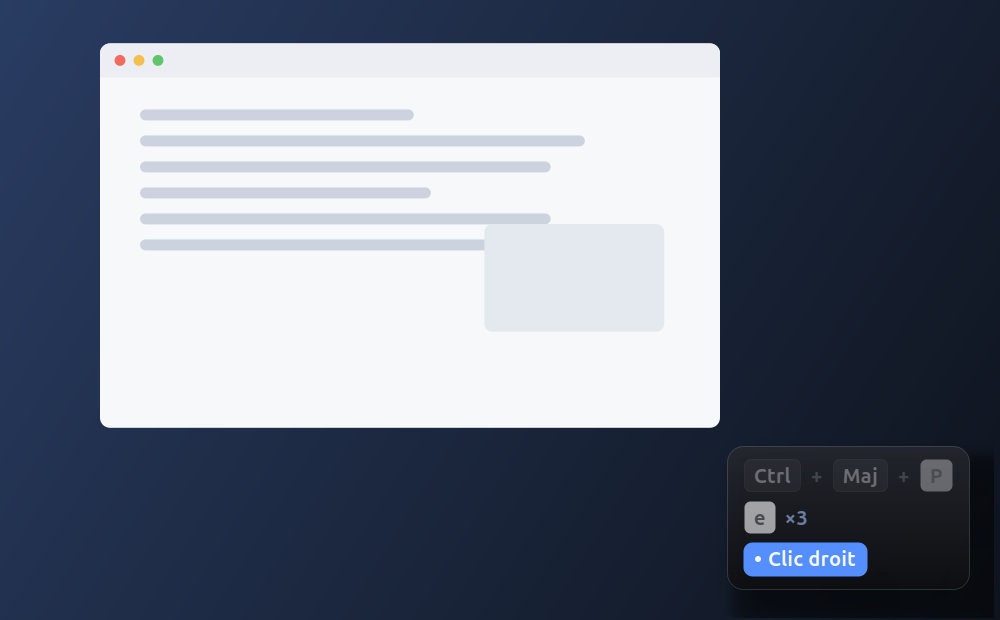
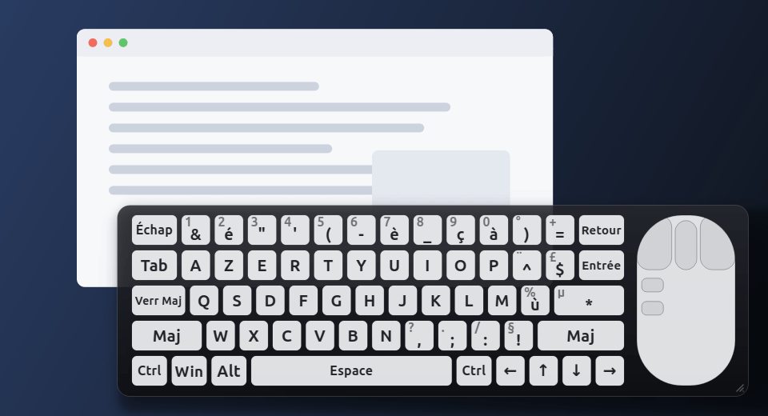
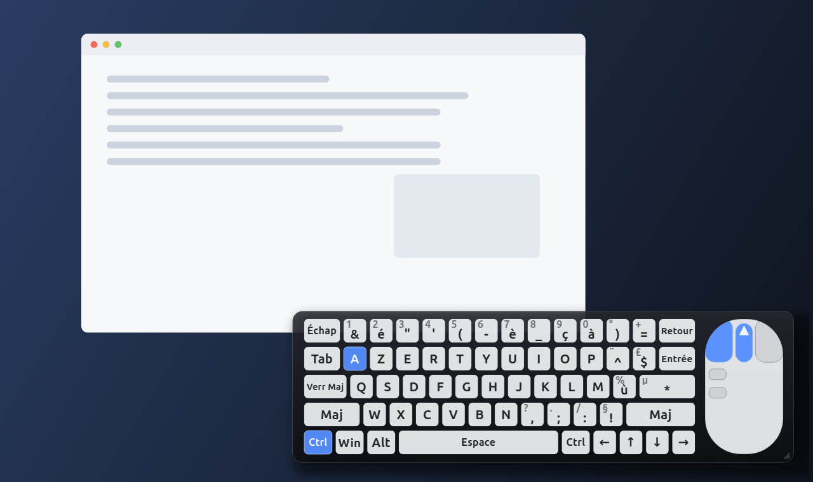
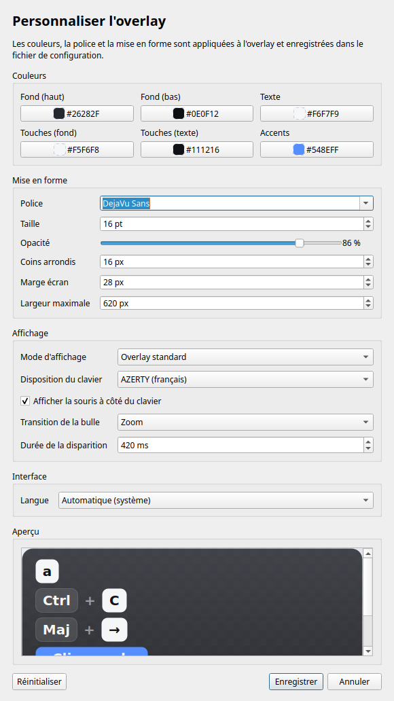
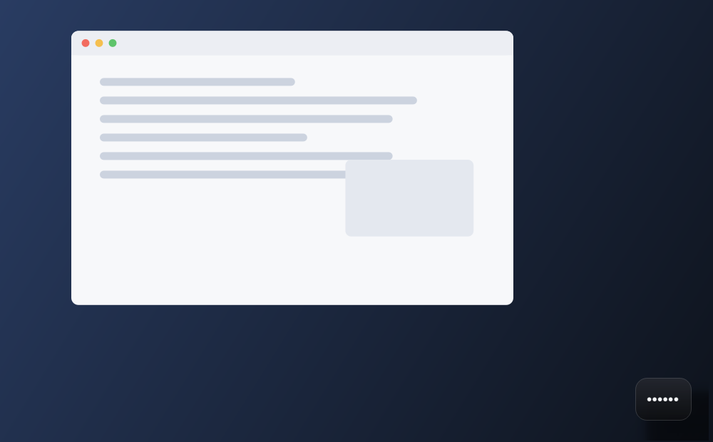
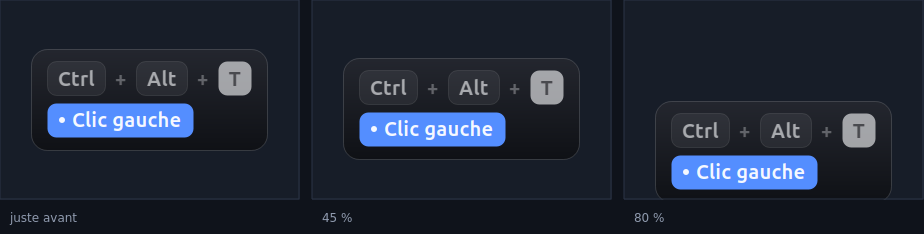
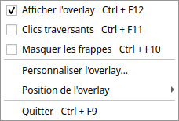

# PressVisual — visualiseur de frappes clavier et de clics souris

[](https://github.com/JessyHurbain/PressVisual/actions/workflows/tests.yml)

PressVisual est une application de bureau Python qui affiche en temps réel, dans une
petite bulle flottante, les touches que vous tapez et les clics que vous faites.
Elle est conçue pour les **captures d'écran**, les **tutoriels** et les
**formations en ligne** : l'overlay est discret, élégant, toujours au premier
plan, et n'apparaît que lorsqu'il y a quelque chose à montrer.





> *Démonstration en mode clavier : les touches s'allument, `Ctrl + C` s'affiche,
> le bouton gauche s'enfonce, la molette tourne, puis la bulle sort en
> glissant. Les captures de cette page sont générées avec l'application
> elle-même ; le fond de bureau et la fenêtre sont une illustration.*

## Sommaire

- [Fonctionnalités](#fonctionnalités)
- [Installation](#installation) — [Tutoriel : première démonstration](#tutoriel--première-démonstration)
- [Lancement](#lancement) — [Options de la ligne de commande](#options-de-la-ligne-de-commande)
- [Utilisation](#utilisation) — [Transitions](#transitions-de-la-bulle),
  [mode clavier](#mode-clavier-complet), [apparence](#personnaliser-lapparence),
  [raccourcis](#raccourcis-globaux), [mode privé](#masquage-et-mode-privé)
- [Configuration](#configuration) — [Détail des clés](#détail-des-clés)
- [Langues](#langues) — [Empaqueter un exécutable](#empaqueter-en-exécutable-autonome)
- [Dépannage](#dépannage) — [Tests](#tests) — [Structure du projet](#structure-du-projet)

## Fonctionnalités

- **Overlay moderne** : coins arrondis, fond sombre dégradé semi-transparent
  (type verre fumé), texte blanc contrasté, police système épurée.
- **Deux modes d'affichage** : les pastilles de frappes habituelles, ou un
  **clavier complet** AZERTY ou QWERTY accompagné d'une **souris** dont les
  touches et les boutons s'allument au fil de la saisie. Le mode se choisit
  dans la fenêtre de personnalisation.
- **Apparence personnalisable** : une fenêtre de réglages avec aperçu en direct
  permet de changer les couleurs, la police, l'opacité, les coins arrondis et
  les marges, puis d'enregistrer le tout dans la configuration.
- **Fenêtre sans bordure**, toujours au premier plan, déplaçable au clic-glisser.
- **Apparition et disparition animées** : fondu, glissements dans les quatre
  directions, zoom ou disparition immédiate, avec la durée de votre choix ; le
  maintien à l'écran reste configurable (2 s par défaut).
- **Capture globale** du clavier et de la souris via `pynput`, dans un fil
  séparé : l'interface reste fluide même pendant une frappe rapide.
- **Combinaisons de touches** affichées en badges :
  `[Ctrl] + [Maj] + [P]`, `[Alt] + [Tab]`, `[Maj] + [→]`, etc.
- **Affichage touche par touche** : chaque frappe apparaît dans sa propre
  pastille (`[b]`, `[o]`, `[n]`, `[Entrée]`, `[Ctrl] + [Maj] + [P]`…), sans
  regrouper les lettres en mots. Un mode optionnel (`concat_text`) reforme le
  texte saisi sur une seule ligne si vous le préférez.
- **Pavé numérique** : chiffres `0` à `9`, opérateurs `+ - * /`, séparateur
  décimal et touche Entrée reconnus, y compris lorsque `pynput` ne fournit pas
  de caractère pour ces touches.
- **Souris** : clic gauche, clic droit, clic milieu, boutons latéraux
  (`[Précédent]`, `[Suivant]`), double-clic, triple-clic et molette, verticale
  (`Scroll ↑`, `Scroll ↓`) comme horizontale sur une molette inclinable
  (`Scroll ←`, `Scroll →`). Les crans successifs sont agrégés par axe :
  `Scroll ↓ ×3`, `Scroll → ×2`.
- **Combinaisons souris** : les modificateurs maintenus accompagnent la molette
  et les clics, comme au clavier : `[Ctrl] + [Scroll ↑]` (zoom),
  `[Maj] + [Clic droit]`, `[Ctrl] + [Clic milieu]`, etc.
- **Raccourcis globaux** pour masquer l'overlay, le rendre transparent aux clics,
  masquer les frappes sensibles ou quitter.
- **Mode privé** : `Ctrl + F12` masque tout et suspend la capture ; les frappes
  ne sont ni affichées ni conservées.
- **Mode masqué** : `Ctrl + F10` remplace les caractères saisis par des puces
  (`••••••`), utile pendant la saisie d'un mot de passe.
- **Filtrage de touches** par configuration (par exemple `F12` ou
  `print_screen`).
- **Menu de notification** (system tray) : afficher/masquer, clics traversants,
  masquage, personnalisation de l'apparence, choix du coin d'ancrage, quitter.
- **Multi-écrans** : positionnement aux quatre coins (haut/bas, gauche/droite)
  ou en bas au centre, sur l'écran où se trouve le curseur.
- **Interface bilingue** : français et anglais, suivant la langue du système ou
  forcée avec `--lang` (ou la clé `language` de `config.json`).
- **Aucune donnée envoyée sur le réseau**. L'application est entièrement locale.

## Prérequis

- Python **3.9 ou plus récent** (testé avec Python 3.14.6 sous Windows 11).
- Windows 10/11, macOS 11+ ou Linux avec un serveur **X11** (Wayland : voir la
  section [Dépannage](#dépannage)).
- Les dépendances listées dans `requirements.txt` :
  - `PyQt6` (interface, animations, transparence) ;
  - `pynput` (écoute globale des entrées, multiplateforme).

## Installation

```bash
# 1. Se placer dans le dossier du projet
cd pressvisual

# 2. Créer un environnement virtuel
python -m venv .venv

# 3. L'activer
# Windows (PowerShell ou cmd)
.venv\Scripts\activate
# macOS / Linux
source .venv/bin/activate

# 4. Installer les dépendances
python -m pip install -r requirements.txt
```

## Tutoriel : première démonstration

De l'installation au premier clip, sans ouvrir le fichier de configuration.

### 1. Lancer l'application

```bash
python pressvisual.py
```

Rien ne s'ouvre : c'est normal. L'overlay reste invisible tant qu'il n'y a rien
à montrer, et l'icône PressVisual rejoint la zone de notification. Le terminal
affiche les raccourcis globaux ; laissez-le ouvert pendant la démonstration.

### 2. Taper et cliquer

Appuyez sur quelques touches, puis cliquez : la bulle apparaît en bas à droite
de l'écran, avec une pastille par touche et une par clic. Les modificateurs
maintenus forment une combinaison (`Ctrl + Maj + P`), la molette s'agrège
(`Scroll ↓ ×3`) et les boutons latéraux sont reconnus. Après la dernière entrée,
la bulle reste affichée deux secondes puis s'efface avec la transition choisie.

> Rien ne s'affiche ? Vérifiez que l'application a bien le droit d'écouter le
> clavier sur votre système (voir [Dépannage](#dépannage)).

### 3. Choisir le clavier complet

Clic droit sur l'icône → **Personnaliser l'overlay…** → **Mode d'affichage** →
**Clavier complet**, puis **Enregistrer**. La bulle affiche désormais un clavier
AZERTY (ou QWERTY) et une souris : la touche s'allume tant qu'elle est
enfoncée, le bouton de souris s'enfonce, et un cran de molette s'affiche à côté.



La taille du clavier se règle directement en glissant la poignée du coin bas
droit de la bulle (60 % à 200 %), sans passer par les réglages.

### 4. Ajuster l'apparence et les transitions

La même fenêtre règle les couleurs, la police, l'opacité, les coins arrondis,
la marge et la **transition de la bulle** (fondu, glissements, zoom ou aucune)
avec sa durée. L'aperçu en bas applique chaque changement immédiatement et
rejoue la transition en boucle, pour juger du rendu avant d'enregistrer.



**Enregistrer** applique et conserve les réglages : les valeurs sont écrites
dans `config.json`, à côté de `pressvisual.py` (ou à l'emplacement donné à
`--config`). Au prochain lancement, l'overlay reprend exactement cette
apparence.

### 5. Placer la bulle où elle gêne le moins

Glissez la bulle à la souris pour la poser où vous voulez : la position est
mémorisée au redémarrage. Le sous-menu **Position de l'overlay** de l'icône
propose aussi les quatre coins et le bas centre.

### 6. Pendant la capture

| Geste | Effet |
| --- | --- |
| `Ctrl + F12` | Masquer l'overlay et suspendre la capture (mode privé). |
| `Ctrl + F10` | Remplacer les caractères par des points (`••••••`). |
| `Ctrl + F11` | Rendre la bulle transparente aux clics (click-through). |
| `Ctrl + F9` | Quitter PressVisual. |



Ces raccourcis fonctionnent même quand PressVisual n'a pas le focus ; ils se
modifient dans `config.json` (voir [Raccourcis globaux](#raccourcis-globaux)).

## Tests

La suite de tests s'exécute sans ouvrir de fenêtre (greffon Qt `offscreen`) :

```bash
python -m pip install -r requirements-dev.txt
python -m pytest
python -m ruff check .          # analyse statique
python -m pytest --cov          # couverture des modules de pressvisual_app
```

Les tests couvrent la configuration (chargement, validation, enregistrement),
l'analyse des raccourcis et des touches, le fil de capture (modificateurs avec
la souris, molette, double-clic), le rendu de l'overlay (combinaisons, texte
continu, agrégation de la molette, masquage), la fenêtre d'apparence et les
traductions (catalogue complet, `.qm` à jour, rendu en anglais).

Sous Linux sans session graphique, l'import de `pynput` a besoin d'un serveur
X11 : lancez alors `xvfb-run -a python -m pytest`. C'est ce que fait le workflow
[`.github/workflows/tests.yml`](.github/workflows/tests.yml), exécuté à chaque
poussée sur `main` et à chaque pull request. Sa matrice couvre **Linux et
Windows** avec **Python 3.9 à 3.12**, sous le greffon Qt « offscreen » : aucune
fenêtre ne s'ouvre, et rien n'est envoyé au vrai clavier ni à la vraie souris.

Une tâche séparée, **Analyse statique et couverture**, s'exécute une seule fois
(Ubuntu, Python 3.12) et joue deux garde-fous :

- **`ruff`** signale les erreurs réelles, les imports mal ordonnés, les pièges
  classiques et les simplifications évidentes. Le jeu de règles et la version
  visée (Python 3.9) sont fixés dans [pyproject.toml](pyproject.toml), pour que
  le résultat soit identique sur votre machine et dans la CI.
- **`pytest --cov`** mesure la couverture des modules de `pressvisual_app` :
  elle est aujourd'hui d'environ **91 %**, avec un plancher à **85 %** qui fait
  échouer la CI si elle s'effondre. Le seuil est défini par `fail_under` dans
  [pyproject.toml](pyproject.toml), et `--cov-report=term-missing` indique les
  lignes non couvertes.

## Lancement

```bash
python pressvisual.py
# ou, de façon équivalente :
python -m pressvisual_app
```

L'overlay reste invisible tant que vous ne tapez pas et ne cliquez pas.
L'icône PressVisual apparaît dans la zone de notification.

**Une seule instance à la fois.** Si PressVisual tourne déjà, un nouveau
lancement affiche « PressVisual est déjà lancé : une seule instance peut
capturer le clavier. » sur la sortie d'erreur et se ferme aussitôt (code de
sortie 1) ; un exécutable sans console affiche le même message dans une boîte
de dialogue. Deux instances écouteraient le même clavier et afficheraient deux
fois chaque frappe. Le verrou est un fichier par utilisateur dans le dossier
temporaire (`pressvisual-<uid>.lock`) ; il est libéré à la fermeture, et un
verrou laissé par un processus qui a planté est récupéré automatiquement.
`--help` reste disponible même quand une instance tourne.

### Options de la ligne de commande

| Option | Description |
| --- | --- |
| `--config FICHIER` | Charge un fichier JSON de configuration. |
| `--lang LANGUE` | Langue de l'interface : `auto` (locale du système), `fr` ou `en`. |
| `--duration SEC` | Durée de maintien après la dernière entrée (0,3 à 30 s). |
| `--opacity VALEUR` | Opacité du fond, de `0.15` à `1.0`. |
| `--font-size PT` | Taille de police (9 à 40 pt). |
| `--max-rows N` | Nombre de lignes conservées (1 à 8). |
| `--max-width PX` | Largeur maximale du contenu (220 à 1600 px). |
| `--margin PX` | Marge avec le bord de l'écran (0 à 400 px). |
| `--position POSITION` | `top-left`, `top-right`, `bottom-left`, `bottom-right` ou `bottom-center`. |
| `--no-keyboard` | N'affiche pas les frappes (les raccourcis restent actifs). |
| `--no-mouse` | N'affiche pas les clics ni la molette. |
| `--group-text` | Regroupe les caractères saisis en texte continu au lieu d'une touche par ligne. |
| `--start-hidden` | Démarre en mode privé (capture suspendue). |
| `--click-through` | Démarre en mode clics traversants. |
| `--toggle-hotkey RACCOURCI` | Modifie le raccourci afficher/masquer. |

```bash
# Exemple : bulle en bas au centre, plus grande, affichée 3 secondes
python pressvisual.py --position bottom-center --font-size 20 --duration 3

# Exemple : uniquement la souris, opacité renforcée
python pressvisual.py --no-keyboard --opacity 0.95

# Exemple : regrouper les caractères saisis en texte continu
python pressvisual.py --group-text
```

## Utilisation

### Affichage des frappes

Par défaut, l'overlay affiche **une pastille par touche**, comme un clavier
virtuel : `[b]`, `[o]`, `[n]`, `[Espace]`, `[Entrée]`, `[Maj] + [→]`. Les
caractères ne sont pas regroupés en mots : chaque frappe reste visible
individuellement pendant la durée réglée.

Pour retrouver un affichage en texte continu (`bonjour le monde`), activez
`concat_text` dans la configuration (ou lancez avec `--group-text`). Dans ce
mode, les caractères s'ajoutent à la ligne en cours et une pause de
`typing_join_delay` secondes clôt le mot.

### Positionner et déplacer l'overlay

Le menu de l'icône de notification propose un sous-menu **Position de
l'overlay** avec les quatre coins et le bas centre :

| Choix du menu | Valeur `position` |
| --- | --- |
| Haut gauche | `top-left` |
| Haut droite | `top-right` |
| Bas gauche | `bottom-left` |
| Bas droite | `bottom-right` |
| Bas centre | `bottom-center` |

La bulle se place sur l'écran où se trouve le curseur, à la distance `margin`
des bords. Elle peut aussi être déplacée librement au clic-glisser ; après un
déplacement, PressVisual conserve les bords les plus proches du centre de
l'écran, de sorte que la bulle grandisse vers le centre au fil des frappes au
lieu de sortir par un bord. Pendant le glisser, la disparition automatique est
suspendue et un fondu déjà commencé est annulé : la bulle ne s'efface pas sous
la main. Une fois posée, elle reste affichée un délai complet
(`display_duration`) avant de s'effacer — en fondu, en glissement, en zoom ou
d'un coup, selon `transition` et sa durée `transition_out_ms`. Un dépôt hors de
l'écran est ramené dans la zone visible.

Le coin choisi dans le sous-menu est **mémorisé automatiquement** dans
`config.json` : PressVisual s'ouvre au même endroit au prochain lancement. Un
déplacement libre à la souris est mémorisé de la même façon, sous la clé
`free_position` : la bulle se rouvre exactement là où vous l'avez laissée, même
sur un autre écran, et aucun coin n'est coché dans le menu. Revenir à un coin
préréglé efface `free_position` et redevient la préférence. Si l'écran a changé
de taille ou n'existe plus, la bulle est ramenée dans la zone visible.

La position initiale se règle aussi avec `--position` ou la clé `position` de
`config.json`.

### Transitions de la bulle

La bulle apparaît et disparaît avec la **même** transition, choisie dans la
fenêtre de personnalisation (groupe **Affichage**) ou avec la clé `transition`
de `config.json` :

- **Fondu** (`"fade"`, par défaut) : l'opacité de la fenêtre monte à
l'apparition et descend jusqu'à zéro à la disparition.
- **Glissements** (`"slide"` vers le bas, `"slide-up"` vers le haut,
`"slide-left"` vers la gauche, `"slide-right"` vers la droite) : la bulle
sort par le bord indiqué, puis se masque et reprend sa position d'ancrage ;
à l'apparition, elle revient du même bord. Utile quand le fondu ne se voit
pas : sans compositeur (X11 minimal), le système ignore la transparence des
fenêtres.
- **Zoom** (`"zoom"`) : la bulle rétrécit jusqu'à 90 % en s'effaçant, et
grossit de la même façon en apparaissant.
- **Aucune** (`"none"`) : la bulle s'affiche et disparaît immédiatement,
sans animation.

La durée de la disparition va de 0 à 3000 ms (`transition_out_ms`) ; à 0, la bulle
part d'un coup quelle que soit la transition. L'apparition reprend la même
transition sur `transition_in_ms` (120 ms par défaut), ou sur
`transition_out_ms` s'il est plus court, pour qu'une frappe allume la bulle
sans délai. Une frappe pendant la disparition rappelle la bulle à sa place,
sans la laisser à moitié sortie.

La fenêtre de personnalisation rejoue la transition en boucle dans son
**Aperçu** : la bulle sort puis revient à la cadence choisie, ce qui permet de
comparer les styles et d'ajuster la durée sans quitter les réglages.



### Mode clavier complet

Avec `"display_mode": "keyboard"`, la bulle affiche un **clavier compact** à
la place des pastilles, flanqué à sa droite d'une **souris** : chaque touche
s'allume **tant qu'elle est enfoncée** et s'éteint dès le relâchement ; les
modificateurs (Ctrl, Alt, Maj, Win) restent allumés tant qu'ils sont maintenus,
et seule la touche réellement tenue s'allume : le Ctrl gauche n'allume pas
celui de droite.
Il n'y a ni ligne de texte ni badge de clic : seuls le clavier et la souris
réagissent, ce qui met le geste en avant pour une démonstration ou un tutoriel.

- Deux dispositions : **AZERTY** (par défaut) et **QWERTY**, réglables dans la
  fenêtre de personnalisation ou avec `keyboard_layout`.
- Clavier compact : lettres, chiffres et ponctuation courante, Tab, Verr Maj,
  Maj, Ctrl, Alt, Win, Espace, Entrée, Retour, Échap et flèches.
- Souris schématique : **bouton gauche**, **bouton droit**, **molette** et les
  deux **boutons latéraux** (Précédent, Suivant). Un bouton s'allume tant qu'il
  est enfoncé ; un cran de molette allume la molette et un triangle indique le
  sens du défilement (haut, bas, gauche, droite) pendant un court instant,
  puisqu'un cran n'a pas de relâchement. Avec `"capture_mouse": false`, la
  souris n'est pas dessinée.
- Trois dessins de souris, réglables dans la fenêtre de personnalisation ou
  avec `mouse_style` : **Classique** (fond plein, boutons séparés), **Contour**
  (traits seuls, sans fond) et **Minimal** (silhouette où seuls les gestes
  apparaissent ; la molette reste dessinée au repos).
- La souris se masque sans changer de mode : décochez **Afficher la souris à
  côté du clavier** dans la fenêtre de personnalisation, ou mettez
  `"show_mouse": false`. Le clavier reste alors seul dans la bulle.
- **Taille réglable à la souris** : la petite poignée en bas à droite de la
  bulle redimensionne le clavier et sa souris de 60 % à 200 %. Glissez vers
  l'intérieur pour réduire, vers l'extérieur pour agrandir ; la taille est
  mémorisée dans `keyboard_scale` pour le prochain lancement.
- La taille du clavier et de la souris suit la police et sa « Taille » :
  augmentez `font_size` pour une vue plus grande à l'écran, et utilisez la
  poignée ci-dessous pour l'ajuster sans toucher aux réglages.
- Le **mode masqué** (`Ctrl + F10`) n'allume aucune touche de caractère : les
  frappes sensibles ne sont pas révélées, contrairement aux modificateurs et
  aux clics de souris.

Le mode se change à chaud : enregistrer dans la fenêtre de personnalisation
applique immédiatement le clavier ou les pastilles, sans redémarrer.

### Éditeur de touches

L'onglet **Touches** de la fenêtre de personnalisation change la forme des
touches : **Arrondie**, **Carrée**, **Ronde**, **Pilule**, **Hexagone**,
**Losange**, **Fleur** ou **Étoile**. Les vignettes montrent chaque forme sur
un fond de panneau, comme dans l'overlay.

- **Forme par défaut** s'applique à toutes les touches qui n'ont pas
exception ; le changement se voit immédiatement dans l'aperçu.
- **Forme à appliquer** est le pinceau : choisissez une forme, puis cliquez
une touche de la grille pour la lui donner (une fleur pour le A, une étoile
pour Entrée…). Les touches personnalisées sont entourées de la couleur
d'accent.
- **Appliquer à toutes** impose la forme du pinceau au clavier entier et
efface les exceptions ; **Effacer les exceptions** garde la forme par défaut
et rend aux touches leur dessin commun.

Les formes sont conservées dans `key_shape` (forme par défaut) et `key_shapes`
(exceptions, indexées par l'étiquette de la touche) :

```json
{
  "key_shape": "rounded",
  "key_shapes": {"A": "flower", "Entrée": "star", "Espace": "pill"}
}
```

Les formes valent partout où des touches sont dessinées : le clavier complet
**et** les pastilles de la bulle. Le texte reste centré. Sur une touche plus
large que haute (une barre d'espace, une pastille « Entrée » ou « Ctrl »),
une fleur ou une étoile deviendraient si étroites au centre que l'étiquette
sortirait de la forme : elles deviennent alors une **bande festonnée**, même
motif d'un bout à l'autre, qui garde l'étiquette au milieu. Un losange étiré
devient de la même façon une bande à pointes.

Les clics de souris et le texte saisi gardent leur pastille arrondie : la
forme ne concerne que les touches.

### Personnaliser l'apparence

Clic droit sur l'icône de notification → **Personnaliser l'overlay…** ouvre une
fenêtre de réglages avec un aperçu en direct. Les réglages sont répartis en
cinq onglets ; l'aperçu reste visible sous les onglets et les boutons
**Réinitialiser**, **Enregistrer** et **Annuler** restent en bas de la fenêtre,
hors de tout défilement. Si l'écran est trop bas, chaque onglet défile à
l'intérieur plutôt que d'allonger la fenêtre.

- **Affichage** : mode (overlay standard ou clavier complet), disposition du
  clavier (AZERTY ou QWERTY), **design de la souris** (Classique, Contour ou
  Minimal), case **Afficher la souris à côté du clavier**, case **Afficher les
  clics et la molette près du curseur** (suivi de la souris), son
  **design des clics près du curseur** (Classique, Contour ou Touche) et
  **Transition de la bulle** (fondu, glissements dans les quatre directions, zoom ou aucune)
  avec sa durée en millisecondes. L'aperçu bascule immédiatement sur le
  clavier, avec ou sans sa souris.
- **Couleurs** : fond (haut et bas du dégradé), texte, fond et texte des
  touches, couleur d'accent des clics et des messages d'état. Les badges de
  modificateurs, les bordures et les séparateurs sont dérivés de ces couleurs
  pour rester cohérents.
- **Mise en forme** : police, taille, opacité du fond, rayon des coins, marge
  avec le bord de l'écran et largeur maximale.
- **Touches** : forme des touches du clavier et des pastilles, par défaut ou
  touche par touche (voir l'éditeur de touches ci-dessus).
- **Interface** : langue de l'interface (automatique, français ou anglais).
  Le changement s'applique dès l'enregistrement, sans redémarrer.
- **Aperçu animé** : la démonstration joue une frappe et un clic (touche
  `A`, puis `Maj + E` avec un clic droit et un cran de molette), dans le mode
  choisi, pour juger du rendu sans rien taper soi-même. La bulle disparaît et
  revient ensuite avec la transition sélectionnée, sur sa durée réelle (la
  disparition sur `transition_out_ms`, le retour sur `transition_in_ms`) :
  glissements, zoom et fondu se voient donc avant d'enregistrer. Elle ne
  tourne pas en boucle : elle se joue une fois, à l'ouverture de la fenêtre et
  à chaque changement de réglage, puis l'aperçu reste immobile, tandis que les
  couleurs, la police et les formes continuent de suivre les réglages en
  direct. Changer `transition`, `transition_out_ms` ou `transition_in_ms`
  rejoue la transition seule, sans attendre la fin de la frappe simulée.
- **Réinitialiser** restaure les valeurs d'origine, **Annuler** ferme sans rien
  changer et **Enregistrer** applique les réglages immédiatement puis les écrit
  dans le fichier de configuration.

Les réglages sont conservés au prochain lancement. Ils ne touchent ni au
positionnement (le dernier coin choisi reste mémorisé) ni au contenu affiché
(durée, nombre de lignes, clavier/souris).

### Suivi de la souris

La case **Afficher les clics et la molette près du curseur** (clé
`mouse_tracking`) affiche un petit **schéma de souris** à côté du pointeur à
chaque clic et chaque cran de molette : c'est le bouton enfoncé — gauche,
droit, latéral — ou le sens du défilement qui s'allume, sans phrase à lire.
Les modificateurs tenus s'inscrivent à sa gauche (`Ctrl`, `Maj`, `Alt`) et un
clic multiple ajoute son compte (`×2`, `×3`). L'indicateur s'efface seul après
0,7 s, ne prend ni le focus ni les clics, et suit le thème de l'overlay.

Activé, il remplace les lignes de clic et de molette de la bulle — le geste
s'affiche là où il se produit — tandis que les frappes continuent d'apparaître
normalement. En mode clavier complet, la souris du schéma s'allume toujours en
même temps.

Le **cadre** autour du schéma se dessine de trois façons, au choix dans la
fenêtre de personnalisation (**Design des clics près du curseur**) ou avec la
clé `cursor_style` :

| Dessin | Rendu |
| --- | --- |
| `classic` | cadre plein de la couleur d'accent. |
| `outline` | fond du panneau et trait d'accent : la version « contour », discrète sur un écran clair. |
| `keycap` | une touche de clavier en miniature, avec son arête plus sombre. |

Le schéma lui-même reprend le **design de la souris** (`mouse_style`) choisi
pour le clavier complet : Classique, Contour ou Minimal, dessiné en petit et
avec des traits renforcés pour rester lisible.

### Raccourcis globaux

| Raccourci (par défaut) | Action |
| --- | --- |
| `Ctrl + F12` | Afficher / masquer l'overlay et suspendre la capture. |
| `Ctrl + F11` | Activer / désactiver les **clics traversants** (click-through). |
| `Ctrl + F10` | Activer / désactiver le **masquage des frappes** (`••••••`). |
| `Ctrl + F9` | Quitter PressVisual. |

Ces combinaisons fonctionnent même quand PressVisual n'a pas le focus. Elles ne sont
jamais affichées dans l'overlay. Elles sont configurables dans `config.json` et
peuvent être désactivées en mettant une chaîne vide :

```json
{
  "hotkey_toggle": "",
  "hotkey_masking": "ctrl+alt+m"
}
```

> Si un raccourci entre en conflit avec une autre application (ou avec macOS),
> remplacez-le dans la configuration. La reconnaissance est stricte : les
> modificateurs enfoncés doivent correspondre exactement.

### Clics traversants

En mode click-through, la bulle reste visible mais tous les clics la traversent :
elle ne gêne plus l'utilisation de l'application filmée. Pour la déplacer à
nouveau ou la reprendre à la souris, appuyez de nouveau sur `Ctrl + F11` (ou
utilisez le menu de l'icône de notification).

### Masquage et mode privé

- `Ctrl + F10` : les caractères saisis apparaissent sous forme de points. Les
  combinaisons de touches (`Ctrl + C`, etc.) restent visibles.
- `Ctrl + F12` : tout est masqué et la capture est suspendue. Idéal pour saisir
  des identifiants pendant une démonstration. Un nouvel appui réactive
  l'affichage.
- `filtered_keys` permet d'ignorer définitivement certaines touches.

### Zone de notification

Un clic sur l'icône affiche ou masque l'overlay. Le menu contextuel (clic droit)
donne accès à toutes les options, notamment **Quitter**.



Si votre système n'affiche pas les icônes de notification, utilisez
`Ctrl + F9` (ou `Ctrl + C` dans le terminal) pour quitter.

## Configuration

PressVisual lit un fichier `config.json` **facultatif** :

- à côté de `pressvisual.py` en exécution depuis les sources ;
- à côté de l'exécutable PyInstaller (`PressVisual.exe`) ;
- à côté du bundle `PressVisual.app` sur macOS ;
- ou n'importe où avec `--config /chemin/config.json`.

Les options de la ligne de commande sont prioritaires sur le fichier. Les clés
inconnues sont ignorées avec un avertissement, et les valeurs hors limites sont
automatiquement corrigées.

Le choix d'un coin dans le menu de l'icône met à jour la clé `position` du
fichier sans toucher aux autres clés ; si `config.json` n'existe pas encore, il
est créé. La fenêtre d'apparence enregistre de la même façon ses propres clés.
Le dossier qui contient le fichier doit donc être accessible en écriture.

### Exemple complet (valeurs par défaut)

```json
{
  "display_duration": 2.0,
  "transition_in_ms": 120,
  "transition": "fade",
  "transition_out_ms": 420,
  "opacity": 0.86,
  "font_family": "",
  "font_size": 16,
  "max_rows": 4,
  "max_width": 620,
  "corner_radius": 16,
  "margin": 28,
  "position": "bottom-right",
  "display_mode": "overlay",
  "keyboard_layout": "azerty",
  "mouse_style": "classic",
  "show_mouse": true,
  "mouse_tracking": false,
  "cursor_style": "classic",
  "key_shape": "rounded",
  "key_shapes": {},
  "keyboard_scale": 1.0,
  "language": "auto",
  "concat_text": false,
  "typing_join_delay": 1.1,

  "background_color": "#26282f",
  "background_color_bottom": "#0e0f12",
  "text_color": "#f6f7f9",
  "key_background_color": "#f5f6f8",
  "key_text_color": "#111216",
  "accent_color": "#548eff",

  "free_position": null,

  "capture_keyboard": true,
  "capture_mouse": true,
  "ignore_key_repeats": true,
  "ignore_overlay_clicks": true,
  "filtered_keys": [],

  "ctrl_label": "Ctrl",
  "alt_label": "Alt",
  "shift_label": "Maj",
  "win_label": "Win",
  "click_left_label": "Clic gauche",
  "click_right_label": "Clic droit",
  "click_middle_label": "Clic milieu",
  "click_back_label": "Précédent",
  "click_forward_label": "Suivant",
  "scroll_up_label": "Scroll ↑",
  "scroll_down_label": "Scroll ↓",
  "scroll_left_label": "Scroll ←",
  "scroll_right_label": "Scroll →",

  "hotkey_toggle": "ctrl+f12",
  "hotkey_click_through": "ctrl+f11",
  "hotkey_masking": "ctrl+f10",
  "hotkey_quit": "ctrl+f9",

  "start_hidden": false,
  "click_through_on_start": false
}
```

### Détail des clés

Les durées s'appelaient `fade_in_ms` et `fade_out_ms` avant que les transitions
dépassent le simple fondu. Ces deux noms restent lus dans un `config.json`
existant, reportés sous leur nouveau nom, puis supprimés du fichier au prochain
enregistrement : rien à réécrire à la main, et la clé actuelle l'emporte si les
deux formes cohabitent.

| Clé | Rôle |
| --- | --- |
| `display_duration` | Secondes de maintien après la dernière entrée (0,3 à 30). |
| `transition_in_ms` | Durée de la transition d'apparition (0 à 2000 ms). |
| `transition` | Transition de la bulle, à l'apparition comme à la disparition : `fade` (fondu), `slide` / `slide-up` / `slide-left` / `slide-right` (glissements), `zoom` ou `none` (immédiate). |
| `transition_out_ms` | Durée de la transition de disparition (0 à 3000 ms) ; plafonne aussi l'apparition. |
| `opacity` | Opacité du fond de l'overlay (0.15 à 1.0). |
| `font_family` | Police ; vide = sélection automatique (Segoe UI, SF Pro, Inter…). |
| `font_size` | Taille de police en points. |
| `max_rows` | Nombre de lignes conservées à l'écran (les plus anciennes s'effacent). |
| `max_width` | Largeur maximale du texte ; le début est tronqué avec `…`. |
| `corner_radius` | Rayon des coins de la bulle. |
| `margin` | Distance au bord de l'écran pour le positionnement initial. |
| `background_color` | Couleur du haut du dégradé de fond (format `#RRGGBB`). |
| `background_color_bottom` | Couleur du bas du dégradé de fond. |
| `text_color` | Couleur du texte, des badges de modificateurs et des bordures. |
| `key_background_color` | Fond des pastilles de touches. |
| `key_text_color` | Texte des pastilles de touches. |
| `accent_color` | Accent des clics souris, des messages d'état et de la molette. |
| `position` | `top-left`, `top-right`, `bottom-left`, `bottom-right` ou `bottom-center`. |
| `display_mode` | `overlay` (pastilles de frappes) ou `keyboard` (clavier compact dont les touches s'allument). |
| `keyboard_layout` | `azerty` ou `qwerty`, utilisé en mode `keyboard`. |
| `mouse_style` | Dessin de la souris en mode `keyboard`, repris en petit près du curseur : `classic` (fond plein), `outline` (traits seuls) ou `minimal` (silhouette, gestes seuls). Défaut `classic`. |
| `show_mouse` | Afficher la souris à côté du clavier en mode `keyboard` (défaut `true`). |
| `mouse_tracking` | Pastille près du curseur pour chaque clic et cran de molette, au lieu des lignes correspondantes dans la bulle (défaut `false`). |
| `cursor_style` | Cadre de l'indicateur près du curseur : `classic` (accent plein), `outline` (fond du panneau, trait d'accent) ou `keycap` (touche de clavier). Défaut `classic`. |
| `key_shape` | Forme des touches du clavier complet : `rounded`, `square`, `circle`, `pill`, `hexagon`, `diamond`, `flower` ou `star`. Défaut `rounded`. |
| `key_shapes` | Formes propres à certaines touches, indexées par leur étiquette, par exemple `{"A": "flower", "Entrée": "star"}`. Les autres gardent `key_shape`. |
| `keyboard_scale` | Taille du clavier et de la souris, de `0.6` à `2.0` (défaut `1.0`), réglée avec la poignée de la bulle. |
| `free_position` | Position libre enregistrée après un glisser, sous la forme `[x, y, largeur, hauteur]`. `null` = aucun déplacement manuel mémorisé. |
| `language` | Langue de l'interface : `auto` (défaut, locale du système), `fr` ou `en`. |
| `concat_text` | `false` (défaut) : une pastille par touche. `true` : les caractères s'ajoutent dans une ligne de texte. |
| `typing_join_delay` | Pause (s) qui clôt la ligne de texte en mode `concat_text`. |
| `capture_keyboard` | Afficher les frappes (les raccourcis restent actifs même si `false`). |
| `capture_mouse` | Afficher les clics et la molette. |
| `ignore_key_repeats` | Ne pas répéter une touche maintenue enfoncée. |
| `ignore_overlay_clicks` | Ne pas afficher les clics effectués sur la bulle elle-même. |
| `filtered_keys` | Jetons de touches à ignorer (`"f12"`, `"print_screen"`, `"a"`…). |
| `*_label` | Libellés des badges. Leurs valeurs par défaut sont traduites avec l'interface ; une valeur personnalisée est affichée telle quelle (par exemple `win_label` à `"Cmd"` sous macOS). |
| `hotkey_*` | Raccourcis globaux au format `modificateur+touche` (chaîne vide = désactivé). |
| `start_hidden` | Démarre avec la capture suspendue. |
| `click_through_on_start` | Démarre en mode clics traversants. |

### Style

La fenêtre **Personnaliser l'overlay…** couvre l'essentiel des réglages
visuels. Pour un changement plus fin, les couleurs acceptent aussi le format
`#AARRGGBB` (alpha en premier) dans le fichier de configuration ; les badges de
modificateurs, les bordures, le séparateur `+` et la couleur du texte sur les
badges d'accent sont alors recalculés à partir de ces valeurs.

Les réglages enregistrés par la fenêtre sont : `background_color`,
`background_color_bottom`, `text_color`, `key_background_color`,
`key_text_color`, `accent_color`, `language`, `opacity`, `font_family`,
`font_size`, `max_width`, `corner_radius` et `margin`.

## Langues

L'interface existe en **français** et en **anglais**. Le français est la langue
source, écrite directement dans `pressvisual.py` ; l'anglais est fourni par le
catalogue `translations/pressvisual_en.qm`.

- `language` dans `config.json`, ou `--lang` en ligne de commande, accepte
  `auto`, `fr` et `en`. `--lang` est prioritaire sur le fichier.
- `auto` (défaut) suit la locale du système : français si elle commence par
  `fr`, anglais sinon.
- La langue se choisit aussi dans **Personnaliser l'overlay… → Interface** ;
  le changement s'applique dès l'enregistrement, sans redémarrage.
- Les libellés de `config.json` restent ceux que vous y avez écrits ; leurs
  valeurs par défaut sont traduites à l'affichage.

```bash
python pressvisual.py --lang en
```

Pour corriger ou compléter une traduction, modifiez
[`translations/pressvisual_en.ts`](translations/pressvisual_en.ts) puis
régénérez le `.qm` :

```bash
python tools/compile_translations.py --verify
```

`lrelease` n'est pas nécessaire : le script écrit directement le format
binaire de Qt, et `--verify` recharge le résultat avec `QTranslator`. Un test
de la suite vérifie que le `.qm` livré correspond bien au `.ts`.

Pour un exécutable PyInstaller, embarquez le dossier des traductions :
`--add-data "translations:translations"` (Windows :
`--add-data "translations;translations"`).

## Empaqueter en exécutable autonome

Installation de PyInstaller :

```bash
python -m pip install pyinstaller
```

### Windows — `PressVisual.exe`

```bash
python -m PyInstaller --noconfirm --clean --onefile --windowed --name PressVisual pressvisual.py
```

L'exécutable est créé dans `dist\PressVisual.exe` (environ 37 Mo, démarrage en
quelques secondes). `--windowed` évite l'ouverture d'une console ; l'application
se pilote par l'icône de notification et les raccourcis globaux.

Pour un démarrage plus rapide (et moins de faux positifs antivirus), préférez un
dossier autonome :

```bash
python -m PyInstaller --noconfirm --clean --onedir --windowed --name PressVisual pressvisual.py
# puis lancez dist\PressVisual\PressVisual.exe
```

Avec une icône personnalisée (fichier `.ico` ou `.icns`) :

```bash
python -m PyInstaller --noconfirm --clean --onefile --windowed --name PressVisual --icon mon-icone.ico pressvisual.py
```

#### Script de build

[`tools/build_windows.ps1`](tools/build_windows.ps1) enchaîne ces étapes à votre
place : environnement virtuel isolé dans `build\windows\`, traductions
compilées, icône `.ico` dessinée par l'application, empaquetage puis livraison
dans `dist\`.

```powershell
powershell -ExecutionPolicy Bypass -File tools\build_windows.ps1
# → dist\PressVisual-<version>-win64.zip  (dossier autonome compressé)
```

Le format par défaut est le dossier autonome : il démarre plus vite et attire
moins de faux positifs antivirus que l'exécutable unique. Pour un fichier `.exe`
seul :

```powershell
powershell -ExecutionPolicy Bypass -File tools\build_windows.ps1 -OneFile
# → dist\PressVisual-<version>-win64.exe
```

Options : `-Version 1.0.0` (sinon `git describe`), `-SkipInstall` pour réutiliser
l'environnement déjà créé, `-Python` pour choisir l'interpréteur. Les dépendances
ne sont réinstallées que si `requirements.txt` change.

C'est exactement ce script que la CI exécute sur un runner Windows pour joindre
un `PressVisual-<version>-win64.exe` à chaque release (voir la section AppImage
ci-dessous).

Placez `config.json` **à côté de l'exécutable** si vous voulez une configuration
persistante. Le coin choisi dans le menu y est enregistré automatiquement ; dans
un dossier protégé en écriture (`C:\Program Files`, par exemple), lancez plutôt
avec `--config "%APPDATA%\pressvisual-config.json"`.

### macOS — `PressVisual.app`

macOS exige un bundle `.app` : sans `--windowed`, PyInstaller ne produit qu'un
exécutable Unix, sans `Info.plist`, sans icône dans le Dock et sans la signature
qui conditionne le lancement sur Apple Silicon.

[`tools/build_macos.sh`](tools/build_macos.sh) enchaîne toutes les étapes :

```bash
bash tools/build_macos.sh
# → dist/PressVisual-<version>-macos-<architecture>.dmg
```

Le script crée un environnement virtuel dans `build/macos/`, y installe PyQt6,
pynput et PyInstaller, compile les traductions, dessine l'icône `.icns` avec
l'application elle-même (les dix tailles réclamées par `iconutil`), empaquette
le bundle avec les imports cachés `pynput.keyboard._darwin` et
`pynput.mouse._darwin`, renseigne la version et le copyright dans l'`Info.plist`,
puis signe le bundle et fabrique l'image disque. Celle-ci contient
l'application et un lien vers `/Applications` : il suffit de la glisser.

```bash
FORMAT=zip bash tools/build_macos.sh       # archive .zip au lieu du .dmg
VERSION=1.0.0 bash tools/build_macos.sh    # version forcée (défaut : git describe)
SKIP_PYINSTALLER=1 bash tools/build_macos.sh   # réemballe un bundle déjà construit
CODESIGN_ID="Developer ID Application: …" bash tools/build_macos.sh
```

`PYTHON=python3.12` choisit l'interpréteur, les dépendances ne sont
réinstallées que si `requirements.txt` change.

**Architecture.** Le build cible la machine qui l'exécute — `arm64` sur Apple
Silicon, `x86_64` sur Intel — et le nom du fichier le mentionne. Il n'existe pas
de build universel : construisez une image disque par architecture.

**Premier lancement.** macOS demande l'autorisation de surveiller le clavier :
acceptez, ou ajoutez PressVisual dans **Réglages Système → Confidentialité et
sécurité → Accessibilité**, puis relancez l'application. Sans cette
autorisation, la bulle s'affiche mais reste vide.

**Gatekeeper.** Une image disque non notariée est mise en quarantaine au
téléchargement. Le cas échéant :

```bash
xattr -dr com.apple.quarantine /Applications/PressVisual.app
```

ou *Ouvrir* par le menu contextuel. Pour une distribution publique, signez avec
un certificat Developer ID et notarisez (`notarytool`) ; `CODESIGN_ID` sert
précisément à cela.

**Configuration.** Contrairement à Windows et Linux, un bundle `.app` n'écrit pas
à côté de son exécutable : les réglages vont dans
`~/Library/Application Support/PressVisual/config.json`, y compris lorsque
l'application est installée dans `/Applications`. `--config` impose un autre
emplacement.

### Linux

```bash
python -m PyInstaller --noconfirm --clean --onefile --name PressVisual pressvisual.py
# puis : ./dist/PressVisual
```

`--windowed` est inutile sous Linux. Un serveur X11 (ou une session Xorg) est
nécessaire pour les raccourcis globaux.

#### AppImage

Pour un paquet distribuable, [`tools/build_appimage.sh`](tools/build_appimage.sh)
fabrique un AppImage complet, sans toucher à l'environnement Python du système :

```bash
bash tools/build_appimage.sh
```

Le script crée un environnement virtuel dans `build/appimage/`, y installe
PyQt6, pynput et PyInstaller, compile les traductions, empaquette l'application
en dossier autonome, dessine l'icône 512×512 avec l'application elle-même, puis
assemble l'AppImage avec `appimagetool` (téléchargé automatiquement au premier
lancement). Le résultat :

```
dist/PressVisual-<version>-x86_64.AppImage    # environ 55 Mo
```

La version vient de `git describe` ; `VERSION=1.0 bash tools/build_appimage.sh`
en force une autre, et `SKIP_PYINSTALLER=1` réutilise l'empaquetage déjà présent
pour ne refaire que l'AppImage.

L'`AppRun` embarqué lance l'application avec `--config
"${XDG_CONFIG_HOME:-$HOME/.config}/pressvisual/config.json"`. C'est nécessaire :
un AppImage est monté en lecture seule, donc la configuration ne peut pas être
écrite à côté de l'exécutable. Position libre, apparence, langue et échelle du
clavier sont ainsi conservées d'un lancement à l'autre.

Pour lancer l'AppImage, FUSE doit être disponible ; sinon,
`./PressVisual-x86_64.AppImage --appimage-extract-and-run` fonctionne partout.
La fabrication, elle, n'exige pas FUSE. Construisez de préférence sur la
distribution la plus ancienne que vous ciblez : l'AppImage hérite de sa version
de glibc.

**Publication automatique.** Pousser un tag `v*` déclenche
[`.github/workflows/release.yml`](.github/workflows/release.yml) : la suite de
tests est rejouée, puis **trois binaires** sont construits avec le numéro du tag
— l'AppImage sur Ubuntu, le `.exe` sur Windows et le `.dmg` sur macOS —, chacun
conservé comme artefact du workflow. Une quatrième tâche attend les trois et les
attache à la release GitHub du tag, créée si elle n'existe pas encore. Un
lancement manuel du workflow produit seulement les artefacts, sans toucher aux
releases.

Les notes de release sont **le message du tag annoté** :

```bash
git tag -a v1.1.0 -m "v1.1.0 — ce qui change

Le détail, en quelques lignes."
git push origin v1.1.0
```

C'est ce message qui s'affiche, et non un « Full Changelog » vide —
`--generate-notes` ne remplit rien tant que le projet n'utilise pas de pull
requests. Un tag léger (créé sans `-a`) n'a pas de message : le workflow
détecte le type du tag et retombe alors sur les notes générées.

Si l'une des trois constructions échoue, aucune release n'est créée : c'est
volontaire, une version à moitié publiée serait pire que pas de version.

Le `.dmg` est construit sur le runner `macos-26`, donc en **arm64**. Une image
disque Intel demande un runner `macos-26-intel` ou une machine Intel :
[`tools/build_macos.sh`](tools/build_macos.sh) s'y exécute de la même façon et
nomme le fichier d'après l'architecture.

```bash
git tag v1.0.0
git push origin v1.0.0
```

### Notes de packaging

- Testé avec **PyInstaller 6.22.3**, PyQt6 6.11.0 et pynput 1.8.2 sous Windows 11.
- Si l'exécutable démarre mais que le clavier n'est pas capturé, forcez les
  modules de plateforme de pynput :

  ```bash
  # Windows
  python -m PyInstaller --noconfirm --clean --onefile --windowed --name PressVisual \
    --hidden-import pynput.keyboard._win32 \
    --hidden-import pynput.mouse._win32 pressvisual.py
  ```

  Sur macOS, utilisez `pynput.keyboard._darwin` et `pynput.mouse._darwin` ;
  sur Linux X11, `pynput.keyboard._xorg` et `pynput.mouse._xorg`.
- Les exécutables PyInstaller non signés peuvent déclencher SmartScreen ou un
  antivirus. C'est un faux positif lié à l'empaquetage ; signez le binaire ou
  distribuez une version `--onedir`.
- Le fichier `config.json` n'est pas embarqué automatiquement dans le binaire :
  il est lu à côté de l'exécutable au démarrage, et le menu y enregistre le
  dernier coin choisi. Le bundle macOS fait exception : ses réglages vont dans
  `~/Library/Application Support/PressVisual/`, un `.app` installé dans
  `/Applications` n'étant pas inscriptible.
- Le dossier `translations/` doit être embarqué pour l'interface anglaise :
  ajoutez `--add-data "translations:translations"` (Windows :
  `--add-data "translations;translations"`). Sans lui, l'application reste en
  français.

## Dépannage

**Aucune bulle n'apparaît**
Vérifiez que l'icône est présente dans la zone de notification, appuyez sur
`Ctrl + F12`, puis tapez du texte. Vérifiez aussi `capture_keyboard`,
`capture_mouse`, `filtered_keys` et le mode clics traversants.

**Les raccourcis globaux ne fonctionnent pas**
Un autre logiciel (ou le système) intercepte peut-être `Ctrl + F12`. Changez
`hotkey_toggle` dans `config.json`. Sous macOS, autorisez l'application dans
**Accessibilité**.

**macOS ne capte rien**
Réglages Système → Confidentialité et sécurité → Accessibilité : ajoutez le
Terminal (si vous lancez `python pressvisual.py`) ou `PressVisual.app`, puis
quittez et relancez.

**Linux / Wayland**
Les hooks globaux de `pynput` nécessitent X11. Sous Wayland, connectez-vous à une
session « Xorg » pour un fonctionnement complet ; XWayland peut autoriser
l'affichage mais la capture globale peut être incomplète selon le compositeur.

**Les boutons latéraux de la souris ne s'affichent pas**
`pynput` ne les transmet que sous Windows (boutons `x1`/`x2`) et sous X11
(numéros `8`/`9`). Sous macOS, seuls les boutons gauche, droit et milieu sont
accessibles : les boutons latéraux n'apparaissent pas. Certaines souris
assignent d'autres numéros à leurs boutons via leur pilote ; dans ce cas ils
sont ignorés, comme tout bouton inconnu.

**L'overlay n'apparaît pas dans l'enregistrement**
Utilisez une capture d'**écran** (display capture) plutôt qu'une capture de
fenêtre : l'overlay est une fenêtre séparée.

**Jeux en plein écran exclusif**
L'overlay peut ne pas s'afficher au-dessus d'un jeu en plein écran exclusif.
Utilisez le mode « fenêtré sans bordure ».

**La bulle ne se déplace plus**
Le mode clics traversants est probablement actif : `Ctrl + F11`.

**Les réglages ne sont pas mémorisés**
Le dossier de `config.json` n'est pas accessible en écriture (par exemple
`C:\Program Files`) ou le fichier contient un JSON invalide : PressVisual
fonctionne mais ne peut pas enregistrer le choix (position ou apparence).
Utilisez un dossier inscriptible avec
`--config "%APPDATA%\pressvisual-config.json"`.

**Impossible de quitter**
`Ctrl + F9`, clic droit sur l'icône → Quitter, ou `Ctrl + C` dans le terminal.

## Structure du projet

```
pressvisual.py        Point d'entrée (conserve l'API historique du module)
pressvisual_app/      Code de l'application
  config.py           Chargement, validation et persistance de la configuration
  i18n.py             Traductions et choix de la langue
  keymap.py           Raccourcis, libellés et combinaisons de touches
  capture.py          Écoute globale du clavier et de la souris (pynput)
  events.py           Événements et pont de signaux Qt
  theme.py            Palette et utilitaires de couleur
  keyboard.py         Dispositions AZERTY/QWERTY, vue du clavier et vue combinée
  mouse.py            Souris schématique (boutons et molette)
  widgets.py          Pastilles et lignes de badges
  overlay.py          Fenêtre flottante
  appearance.py       Fenêtre de personnalisation et aperçu
  icon.py             Icône de l'application
  tray.py             Icône de notification et menu
  cli.py              Ligne de commande et démarrage
translations/         Catalogues de traduction (.ts source, .qm compilé)
tools/                Compilation des .ts en .qm, builds AppImage, Windows et macOS
tests/                Suite de tests hors écran (pytest)
docs/images/          Captures d'écran utilisées par ce README
.github/workflows/    Intégration continue (tests, qualité, releases Linux/Windows)
requirements.txt      Dépendances d'exécution
requirements-dev.txt  Dépendances de développement (pytest, couverture, ruff)
pyproject.toml        Règles de ruff et seuil de couverture
README.md             Ce document
LICENSE               Licence MIT du projet
```

## Licence

PressVisual est distribué sous [licence MIT](LICENSE) : usage personnel ou
professionnel, modification et redistribution sont libres, à condition de
conserver l'avis de copyright. Le logiciel est fourni sans garantie.

Les polices et bibliothèques tierces (Qt, PyQt6, pynput) conservent leurs
propres licences ; les captures d'écran de ce README montrent l'application
telle qu'elle s'exécute localement.
